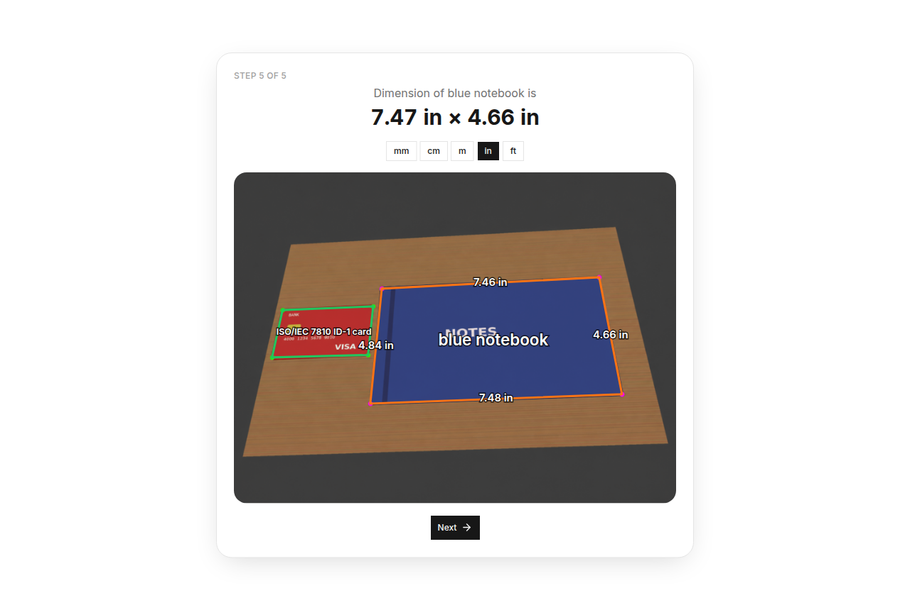
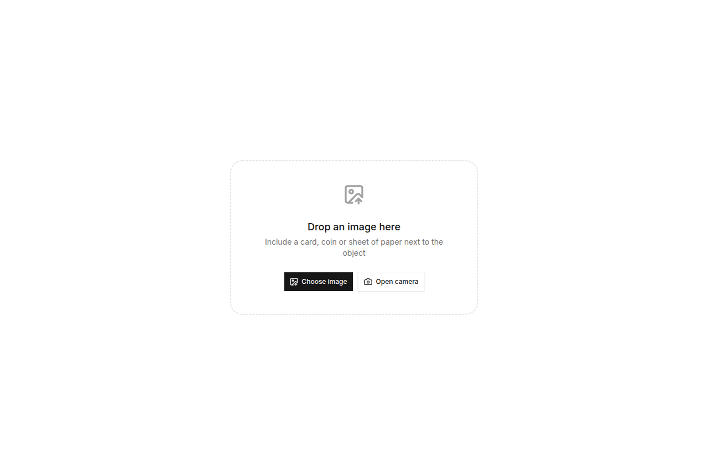
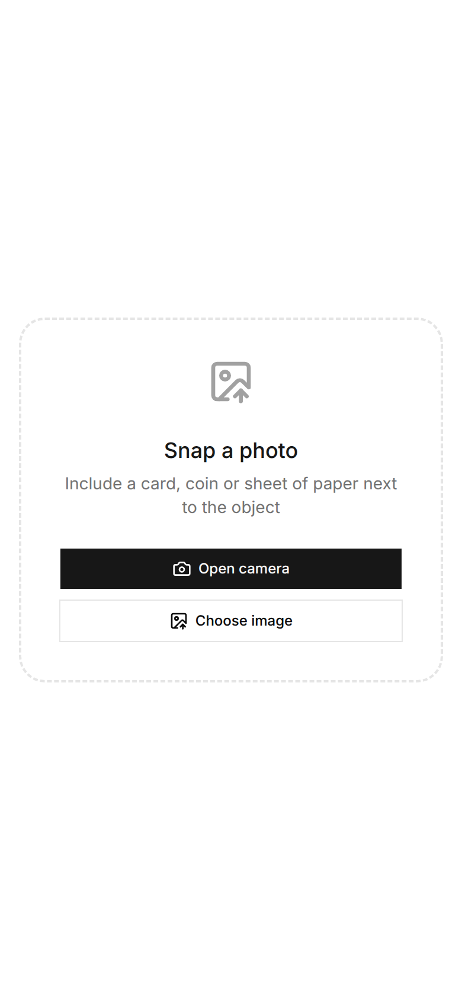
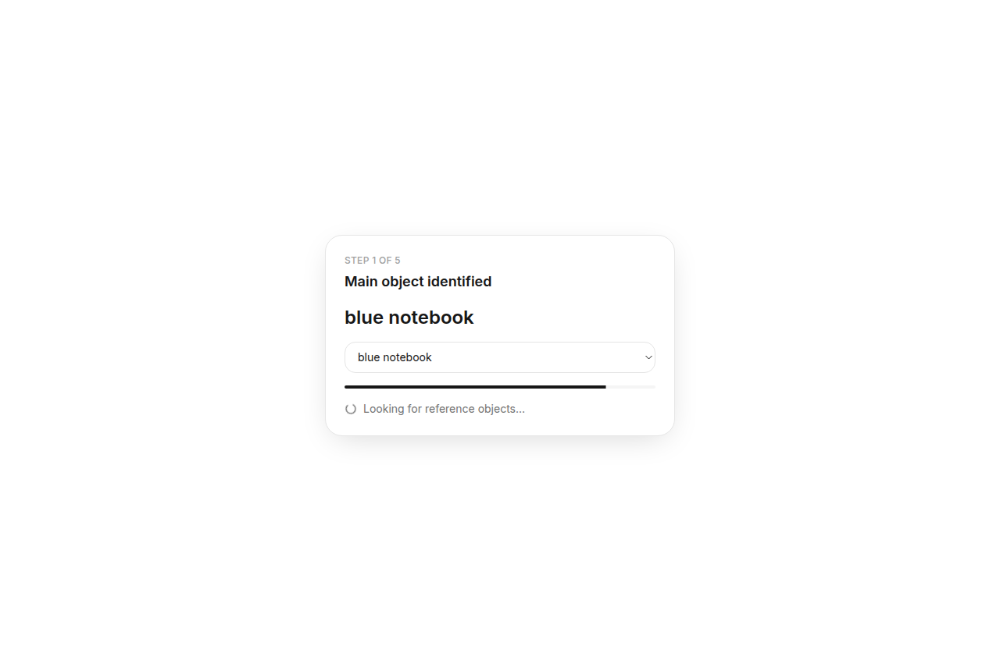
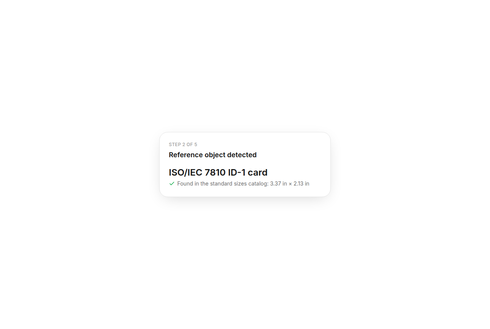
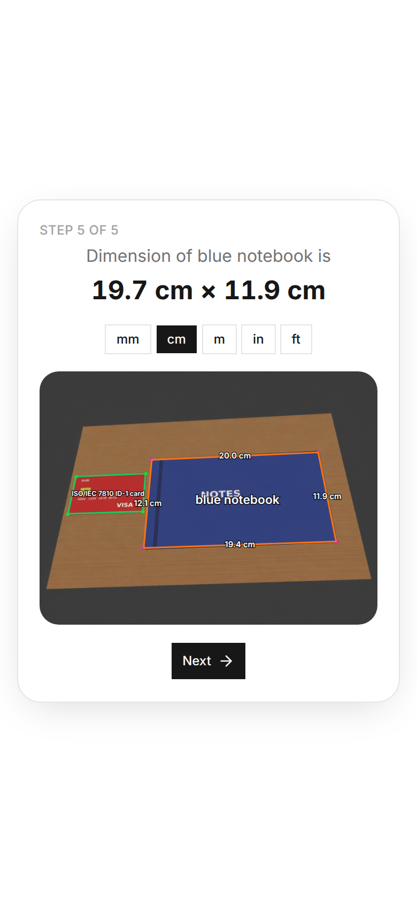
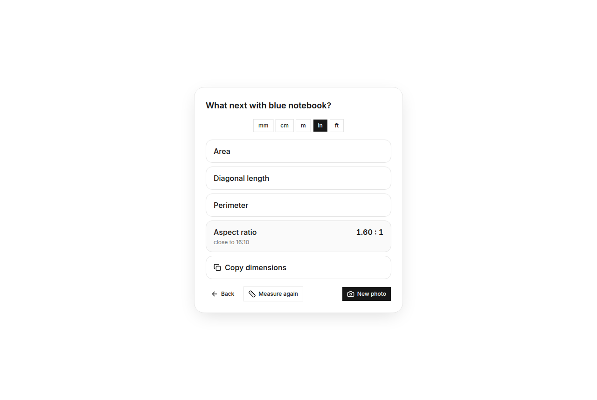
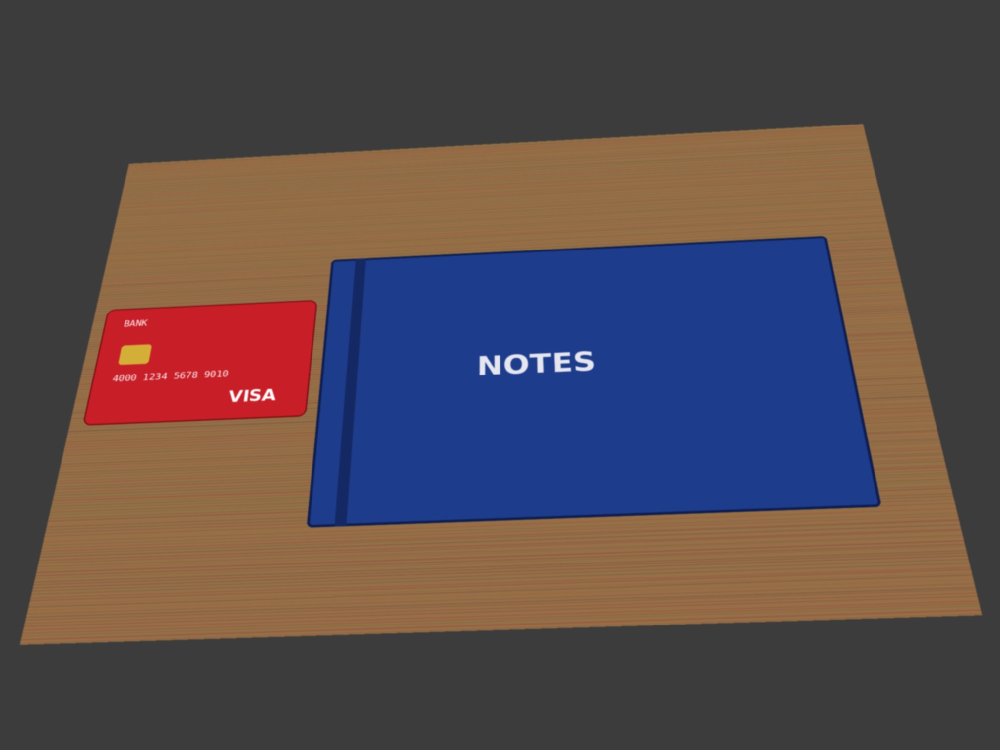

# snap-scale

**Measure anything from a single photo.** Put a card, coin or sheet of paper next to the object, snap a picture, and snap-scale tells you how big the object is.

Live: **https://snap-scale.rajat-ai.workers.dev/**

<p align="center">
  
</p>

## How it works for you

### 1. Snap or drop a photo

The home page has nothing else on it. Drop an image, choose one from your files, or tap **Open camera**:

- **Phone:** opens your camera app directly.
- **Laptop:** opens a live webcam view with a shutter button.

Put something with a standard size in the shot, like a bank card, a coin, an A4 sheet, a banknote or a soda can.

| Desktop | Phone |
|---|---|
|  |  |

### 2. Watch it work, one card at a time

Every step shows up as a card in the middle of the screen. Each card slides in and the previous one fades out.

1. **Main object identified.** It shows what it thinks you want measured. You have 5 seconds to pick a different object from the dropdown, and touching the dropdown pauses the timer.
2. **Reference object detected.** It shows the standard object it found and that object's real size, from a built-in catalog of standard sizes or from a web search.
3. **Adding points to the image.** An image model marks the corners of both objects with bright colored dots.
4. **Calculating pixels.** Your browser finds the dots and the server converts pixel distances into real lengths.

| Pick the main object | Reference found |
|---|---|
|  |  |

### 3. Get the size

The final card says **"Dimension of blue notebook is 19.0 cm × 11.8 cm"**. The photo below it shows both objects outlined, each side's length, and the object's name in the middle.

Switch units with one tap: **mm, cm, m, in, ft**. Your choice is remembered.

<p align="center">
  
</p>

### 4. Next

Tap **Next** for more you can do with the result:

- **Area**
- **Diagonal length**
- **Perimeter**
- **Aspect ratio** (it also tells you when it's close to a common one, like 16:10 or A-paper √2)
- **Copy dimensions**
- **Measure again** or take a **New photo**

<p align="center">
  
</p>

### The test photo

All of the screenshots above come from this photo: a credit card (85.6 × 54 mm) next to a notebook that is really **20 × 12 cm**. snap-scale measured it as 19.0–20.8 cm × 11.8–12.8 cm across runs.

<p align="center">
  
</p>

### Tips for a good result

- Lay the reference object **flat, on the same surface** as the object you're measuring.
- Keep all four corners of both objects in view.
- A straight top-down photo works best. Tilted photos work too, because perspective is corrected.
- It measures **2D surface size** (length × width), not height or volume.
- A measurement takes about 1.5 minutes.

## Tech stack and installation

### How it's built

1. **gpt-5** names the main object, suggests other candidates, and picks a reference. It finds the reference's size in a D1 catalog, or with web search if the reference isn't in the catalog.
2. **gpt-image-2** redraws the photo with green dots on the reference's corners and magenta dots on the main object's corners.
3. The **browser** finds the dots by color and numbers them.
4. **gpt-5** rates how reliable each side looks. Hidden or overlapped edges get a low rating.
5. The **Worker** uses a homography (perspective correction) from the reference's known size to measure the main object. For each pair of opposite sides it uses the better-rated one.

| Layer | Tech |
|---|---|
| Frontend | React Router, Tailwind CSS, shadcn/ui |
| API | Hono and oRPC on Cloudflare Workers |
| Storage | Cloudflare R2 (photos), Cloudflare D1 with Drizzle (results and the reference catalog) |
| AI | OpenAI `gpt-5` and `gpt-image-2` |
| Deploy | Alchemy, run by Cloudflare Workers Builds on every push to `main` |
| Tooling | Bun, Vite+, Biome. Scaffolded with [Better-T-Stack](https://github.com/AmanVarshney01/create-better-t-stack) |

There's no login. Everything runs on Cloudflare.

### Run it locally

You need [Bun](https://bun.sh), a Cloudflare account and an OpenAI API key.

```bash
bun install
```

Create `apps/server/.env`:

```bash
OPENAI_API_KEY=sk-...
CORS_ORIGIN=http://localhost:5173
```

Start the web app and the API:

```bash
bun run dev
```

- Web: http://localhost:5173
- API: http://localhost:3000

### Deploy

```bash
bun run deploy
```

Alchemy creates the D1 database, the R2 bucket and both Workers, and applies migrations. R2 has to be enabled on your Cloudflare account first.

To deploy on every push with **Workers Builds**, import the repo in the Cloudflare dashboard with these settings:

| Setting | Value |
|---|---|
| Build command | (empty) |
| Deploy command | `bun run deploy` |
| Variables | `CLOUDFLARE_API_TOKEN`, `CLOUDFLARE_ACCOUNT_ID`, `OPENAI_API_KEY` |

Other commands:

- `bun run check-types`: type-check every package.
- `bun run db:generate`: create a migration after changing `packages/db/src/schema`.
